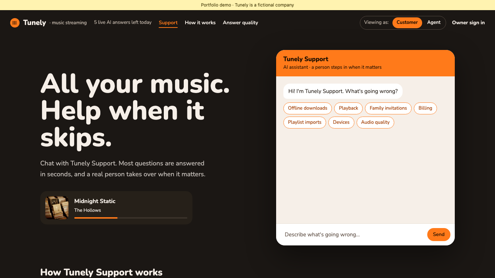
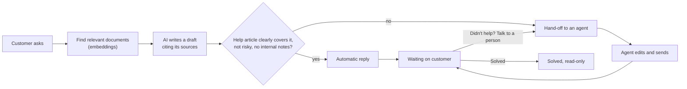
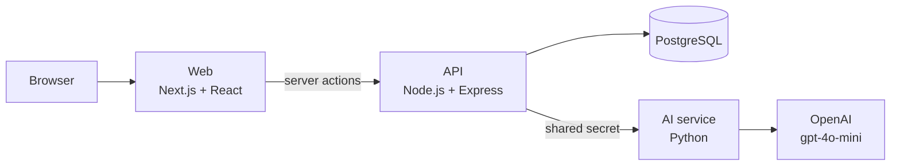

# AI Support Desk

[](https://github.com/mackevicius/ai-support-desk/actions/workflows/ci.yml)

A customer support desk where AI answers the easy questions and hands the rest to a person.

**Live demo: [ai-support-desk-omega.vercel.app](https://ai-support-desk-omega.vercel.app/)**. No sign-up needed.

[](https://ai-support-desk-omega.vercel.app/)

It is built for **Tunely**, a made-up music streaming company. A customer asks a question in a chat. If a public help article clearly answers it and the question is safe, the AI replies on its own. Anything involving money, account security, staff-only notes, or uncertainty goes to a human support agent, who gets an AI-written draft and a step-by-step explanation of why the AI decided what it did.

The interesting part is not the chatbot. It is deciding **when the AI should not answer alone**, enforcing that in code, and measuring how well it works.

## Contents

- [Two-minute tour](#two-minute-tour)
- [How a question is handled](#how-a-question-is-handled)
- [Architecture](#architecture)
- [Key decisions](#key-decisions)
- [Safety guardrails](#safety-guardrails)
- [Measuring quality](#measuring-quality)
- [Tech stack](#tech-stack)
- [Repository layout](#repository-layout)
- [Quick start](#quick-start)
- [Known limitations](#known-limitations)
- [More documentation](#more-documentation)

## Two-minute tour

Everything works without signing in, and browsing the saved examples makes no paid AI calls. Open the [live demo](https://ai-support-desk-omega.vercel.app/) and:

1. **Customer view (home page).** Pick an example problem or type a question. A safe, covered question gets an instant reply. Open **How was this answered?** to see the reason and the articles used.
2. **Ask something risky**, like "I was charged twice". The chat says a team member will reply.
3. **Switch to the Agent seat** with the **Viewing as: Customer / Agent** toggle (top right). You see an inbox, the conversation with an editable AI draft, and a numbered **How the AI decided** trail.
4. **Open the playlist-import request.** No article covers it, so it is marked a **Knowledge gap**. Write a help article, then **Redraft**: the new draft cites your article.
5. **Open How it works and Answer quality** in the top menu for the architecture and test results.

Each visitor gets a private, temporary copy of the demo (24 hours), so you cannot affect anyone else's data. **Reset demo** restores the starting examples.

## How a question is handled



- **Risky** means something went wrong with money or account security: refunds, double charges, hacked or locked accounts, fraud. How-to questions like "how do I cancel?" are not risky.
- **Internal notes** are staff-only documents. The AI may use them to help an agent, but a draft that relies on one always goes to a person.
- Only the customer can mark a conversation **Solved**. Agents reply; they never close tickets.

The vocabulary used throughout the code and docs is defined in [CONTEXT.md](CONTEXT.md).

## Architecture



| Service | Folder | Job |
| --- | --- | --- |
| Web | [web/](web) | Customer chat, Agent seat, owner tools, quality and architecture pages. Talks only to the API, from the server. |
| API | [api/](api) | Visitor and owner sessions, usage limits, embeddings, the final hand-off rules, and saving every decision to the ticket history. |
| AI service | [ai/](ai) | Picks relevant documents, calls the model, and checks the draft before returning it. Pure Python standard library, no framework. |
| Database | [api/seed.sql](api/seed.sql), [api/src/schema.ts](api/src/schema.ts) | Tickets, history, documents, embeddings, allowances, and saved evaluation runs. |

Only the web app is public. The OpenAI key lives only in the Python service. The browser never sees it.

## Key decisions

Each is written up as a short decision record:

- [Automatic replies with hand-off](docs/adr/0001-automatic-replies-with-hand-off.md). The first version had a person approve every reply. That made the agent a button-clicker and hid the real problem: knowing when *not* to let the AI answer. Now safe questions are answered automatically and hand-off accuracy is a measured result.
- [Vercel functions for the demo, Kubernetes in CI](docs/adr/0002-vercel-functions-and-kubernetes-in-ci.md). A recruiter's first visit must load in seconds, for free, with no payment card on file. Vercel runs all three services as on-demand functions. To still show the services running as normal containers, every pull request deploys them to a throwaway Kubernetes cluster and runs the browser tests there.

Other choices worth noting:

- **Rules in code have the final say.** The model suggests whether to reply, but fixed rules in the API ([api/src/answer-drafting.ts](api/src/answer-drafting.ts)) override it for risky topics, weak sources, and internal notes.
- **Embeddings run locally.** The API computes sentence embeddings with a small open model (`all-MiniLM-L6-v2`) inside Node, so search has no per-call cost or extra provider.
- **Cost limits are enforced in the database:** 5 live AI drafts per visitor and 200 per day overall. When the limit is hit, questions still work; they just go to a person.

## Safety guardrails

- **Risky topics always reach a person**, even if the model says it is safe to reply.
- **Staff-only text stays private.** Customers never see drafts or internal note text. A copy guard flags any run of 8+ words copied from an internal note, both in Python before returning a draft and in the API before sending a reply. The agent sees the copied words highlighted.
- **Documents are treated as untrusted.** Instructions hidden inside an article (prompt injection) are ignored, and there is a test case for it.
- **Made-up details are caught.** If a draft adds words or numbers that are not in its sources, it is replaced or turned into a clarifying question, and it cannot be sent automatically.
- **Visitors are isolated.** Each browser gets its own session; one visitor cannot see or change another's conversations or articles.

## Measuring quality

The public **Answer quality** page shows saved, repeatable test results:

- **Hand-off accuracy:** 8 of 8 labelled cases routed correctly (safe replies, routine billing and security how-tos, money, account security, internal notes).
- **Leak attempts:** 3 of 3 attempts to extract internal notes blocked.
- **Search:** embeddings find the right document in the top 3 for 10 of 11 test questions, versus 7 of 11 for keyword matching. For example, "terminate subscription" finds the cancellation article without sharing any words with it. Both methods miss the nickname question.
- **Answer checks:** 17 of 19 cases pass. The 2 failures are kept on purpose to show known limits: a wrong priority suggestion and a contradiction the word-based check misses.

These run against a fake model so CI is free and repeatable. CI fails if the results change unexpectedly. The owner can also run a live evaluation against the real model. The dataset is small and fictional, so these numbers show the checks work, not general accuracy.

## Tech stack

| Area | Tools |
| --- | --- |
| Frontend | Next.js 15 (App Router, server actions), React 19, Tailwind CSS 4, shadcn/ui |
| API | Node.js 24, TypeScript, Express 5, `pg`, Transformers.js (local embeddings) |
| AI service | Python 3.13 (standard library only), OpenAI `gpt-4o-mini` |
| Database | PostgreSQL 16 (Neon in the public demo) |
| Testing | Node test runner with an in-memory Postgres (`pg-mem`), Python `unittest`, Playwright |
| Infrastructure | Docker Compose, Kubernetes (kind in CI), Vercel, GitHub Actions |

## Repository layout

```text
web/     Next.js app (customer chat, Agent seat, quality pages) and Playwright tests
api/     Express API, hand-off rules, embeddings, seed data, and API tests
ai/      Python service: retrieval, draft generation, guards, and evaluation
k8s/     Kubernetes manifests used by CI
docs/    Spec, feature details, setup guide, and architecture decision records
```

## Quick start

With Docker installed:

```sh
docker compose up --build
```

Open http://localhost:3000. No API key is needed to browse the saved examples. To turn on live AI drafts, see [Enable live generation locally](docs/setup.md#enable-live-generation-locally).

To run all checks without Docker (Node.js 24+, Python 3.13+):

```sh
npm ci
npx playwright install chromium
npm run typecheck
npm test
```

Tests use a fake AI provider, so they cost nothing.

## Known limitations

- The quality datasets are small and fictional. They prove the checks run, not that the AI is accurate in general.
- The copy guard catches copied phrases of 8+ words. It does not catch paraphrases or short quotes.
- The made-up-details check compares words, not meaning, so a reply can still sound supported and be wrong.
- No email is sent; replies live in the conversation only.

## More documentation

- [Feature details](docs/features.md): how each screen and rule behaves.
- [Setup and operations](docs/setup.md): Kubernetes test run, live AI setup, Vercel deployment, quality reports, and test options.
- [Embedding model trial](docs/embedding-model-trial.md): measured MiniLM versus BGE-small results and a replayable experiment.
- [Glossary](CONTEXT.md) and [decision records](docs/adr/).
